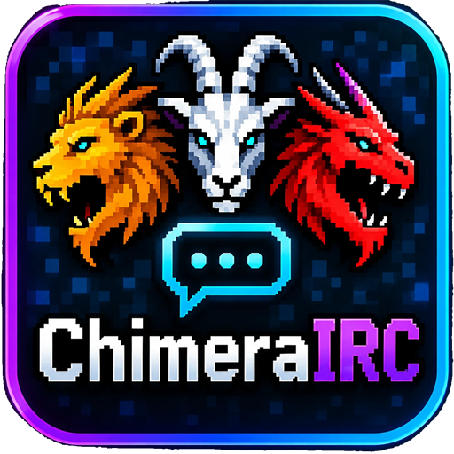
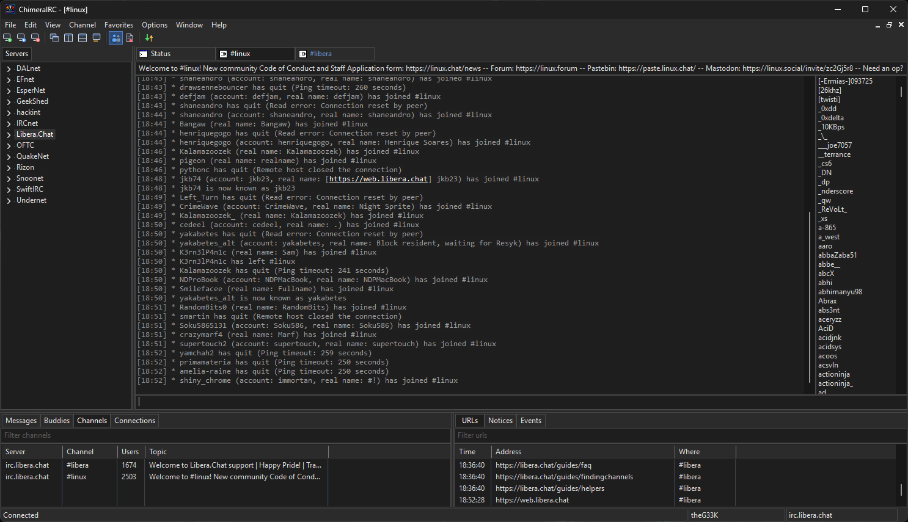
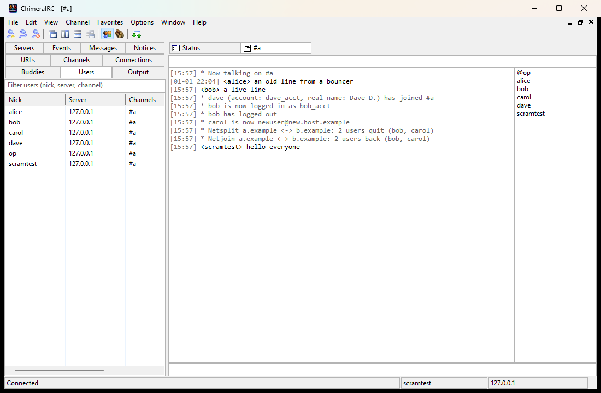

<p align="center">
  
</p>

<h1 align="center">ChimeraIRC</h1>

<p align="center">
  <strong>A Windows IRC client written in Rust, in the spirit of HydraIRC.</strong><br>
  Classic docked-pane look, modern IRCv3 underneath.
</p>

<p align="center">
  <a href="LICENSE"></a>
  
  
  
</p>

<p align="center">
  
  
</p>

---

## ✨ What it is

ChimeraIRC keeps what made [HydraIRC](https://en.wikipedia.org/wiki/HydraIRC) pleasant — MDI chat windows, panes docked
around the edges, a classic menu and toolbar — and rebuilds it as a small, native, memory-safe Win32 program with
current standards: TLS by default, SASL, and the IRCv3 extensions that make IRC feel modern. No runtime, no web view,
one `.exe` of about 6 MB.

## 🚀 Features

| | |
|---|---|
| 🔒 **Secure by default** | TLS everywhere, SASL PLAIN / SCRAM-SHA-256 / EXTERNAL (client certificates), Strict Transport Security. **No password is ever stored**: you are asked each time. |
| 📡 **IRCv3** | `server-time`, `message-tags`, `echo-message`, `extended-join`, `account-notify`, `away-notify`, `chghost`, `setname`, `batch` (netsplit summaries), `chathistory`, typing indicators, `MONITOR`. |
| 🪟 **Docked panes** | Servers, Events, Messages, Notices, URLs, Channels, Connections, Users, Buddies and Output panes; drag them to any edge, split, float, and save up to five layouts. |
| 🎨 **Themes** | Light, Dark or follow Windows, all flat; choose your own chat colors and fonts. |
| 💬 **Chat comforts** | Tab completion, highlights, clickable links (with a "where does this really go" hint), double-click a `#channel` or nick, find in window, log search, multi-line paste protection. |
| 📁 **DCC** | Send and receive files and chats: resume, passive, IPv6, turbo, TLS; UPnP / NAT-PMP / PCP port mapping; drag a file onto a chat to send it. |
| 👥 **People** | Buddy list with groups, ignore list, away marks in the nick list, a global user list. |
| 🧰 **Make it yours** | Identities per network, auto-perform scripts, your own aliases, favorites with auto-join. |
| 📦 **Easy to install** | A per-user MSI (no administrator rights) or a portable ZIP. **Help → Check for Updates…** tells you when a newer release is out. |

## 📥 Install

Download `ChimeraIRC-<version>-x64.msi` (or the portable `.zip`) from the
[Releases page](https://github.com/theG33K/chimerairc/releases) and run it. The installer puts the program in
`%LocalAppData%\Programs\ChimeraIRC` and adds a Start menu shortcut.

> The files are not code-signed yet, so Windows SmartScreen may say "unknown publisher": choose **More info → Run anyway**.

Or build it yourself (see [Build from source](#-build-from-source)).

## ⚡ Quick start

1. Start ChimeraIRC and choose **File → Connect** (<kbd>Ctrl</kbd>+<kbd>S</kbd>), or double-click a network in the **Servers** pane.
2. Or type in the entry box:
   ```
   /server irc.libera.chat
   /join #rust
   ```
   `/server` uses TLS on port 6697 by default; `/server -plain host 6667` connects without TLS.
3. Type `/help` for the list of commands.

## ⌨️ Commands

Everything starts with `/`; anything else you type is said in the current window. Type `/help` in the program for the
full list, and press <kbd>Tab</kbd> to complete commands, `#channels` and nicks.

| Command | What it does |
|---|---|
| `/server [-plain] <host> [port] [nick]` | Connect to a server (TLS unless `-plain`). |
| `/join #chan[,#chan2] [key]`, `/part [#chan] [reason]` | Join or leave channels. |
| `/query <nick> [text]`, `/msg <target> <text>`, `/notice <target> <text>` | Private chats and messages. |
| `/me <action>`, `/say <text>` | Do an action; say a line that starts with a slash. |
| `/nick <newnick>`, `/away [reason]`, `/back`, `/setname <real name>` | Your own identity and status. |
| `/topic [text]`, `/mode [target] <modes>`, `/whois <nick>`, `/list [words]` | Channel and user information. |
| `/ns <command>`, `/cs <command>` | Talk to NickServ / ChanServ (their answers come to the server window; logins are masked). |
| `/ignore [mask]`, `/unignore <mask>` | Hide people (no argument lists the rules). |
| `/buddy add\|remove\|list`, `/monitor + <nick>` | Watch when people come and go. |
| `/history [n]`, `/history before\|after\|around\|between …` | Fetch chat history from servers that have it. |
| `/dcc send <nick> [file]`, `/dcc chat <nick>` | File transfers and direct chats. |
| `/find <text>`, `/logsearch <text>` | Search the window; search your saved logs. |
| `/sound [event sound]` | List the event sounds, try one (`/sound message`) or set one (`/sound private mail`). |
| `/alias [name text]`, `/uptime`, `/identity`, `/perform` | Your own commands, uptime, identities, connect scripts. |
| `/quit [reason]`, `/clear`, `/close`, `/raw <line>` | Leave, tidy up, or send a raw IRC line. |

Handy keys: <kbd>Ctrl</kbd>+<kbd>S</kbd> connect · <kbd>Ctrl</kbd>+<kbd>J</kbd> join · <kbd>Ctrl</kbd>+<kbd>L</kbd> channel list ·
<kbd>Ctrl</kbd>+<kbd>F</kbd> find (<kbd>F3</kbd> next) · <kbd>Ctrl</kbd>+<kbd>Shift</kbd>+<kbd>F</kbd> search logs ·
<kbd>Ctrl</kbd>+<kbd>P</kbd> preferences · <kbd>Alt</kbd>+<kbd>1</kbd>…<kbd>5</kbd> dock layouts ·
<kbd>Ctrl</kbd>+<kbd>Shift</kbd>+<kbd>W</kbd> close window.

## ⚙️ Settings

Almost everything is set from the **Options** menu; the program saves it for you in a plain text file:

```
%AppData%\ChimeraIRC\settings.ini
```

| Where | What you can set |
|---|---|
| **Options → Preferences** (<kbd>Ctrl</kbd>+<kbd>P</kbd>) | Nick, user name, real name, quit message, timestamps, logging and the log folder, history lines on join, DCC address, ports and limits, client certificate. |
| **Options → Theme** | Light, Dark, or Follow Windows. **Chat Colors…**, **Chat Font…** and **Interface Font…** change the look. |
| **Options → Identities…** | A nickname, alternates, user name, real name and SASL account per network (the SASL password is asked at connect time). |
| **Options → Auto-Perform…** | Commands that run when a network connects, e.g. `/msg NickServ identify {ask:Password}` — `{ask:…}` prompts you and never saves it. |
| **Options → Aliases…** | Your own commands: `slap = /me slaps $1 around with a large trout`. |
| **Options → Chat Colors…** | Colors of the chat text, and of owners, admins, ops, half-ops and voiced people in the nick list. |
| **Options → Highlights…** | Words or regular expressions that light up a message: choose the color, limit a rule to some channels (`#rust #py* !#offtopic`, or `query` for private chats) and give it its own sound. |
| **Options → Sounds…** | A sound for each event: highlight, private message, DCC offer, finished transfer, connected, disconnected. Pick a Windows sound or your own `.wav` file; sounds can be limited to when the program is in the background. |
| **Options → Ignore List…** | People to hide. |
| **Options → Show Typing Indicators / Send Typing Notices** | See who is typing; choose whether to tell others you are. |
| **Options → Check for Updates at Start** | Off by default. When on, ChimeraIRC looks for a newer release on GitHub at start-up (at most once a day) and says so in the status window. **Help → Check for Updates…** does it on request. |
| **Favorites** | Servers and channels to join automatically. |
| **View → Layouts** | Save and recall up to five arrangements of the docked panes. |

### 🗄️ Where your data is kept

Everything is stored per user, outside the program's install folder, so upgrading or uninstalling ChimeraIRC never
touches it.

| What | Where |
|---|---|
| **All settings** — nick and identity, Preferences, theme, colors and fonts, dock layouts, window positions and sizes, servers and favorites, identities, auto-perform scripts, aliases, highlights, buddies, ignores, typing options, servers that must use TLS | `%AppData%\ChimeraIRC\settings.ini` (usually `C:\Users\<you>\AppData\Roaming\ChimeraIRC\settings.ini`) |
| **Chat logs** (when logging is on) | `%AppData%\ChimeraIRC\logs\`, or the folder you choose in Preferences: one folder per server, one file per channel or private chat |
| **Pictures you paste to send over DCC** | `%TEMP%\ChimeraIRC\` (small temporary files) |
| **Files you receive over DCC** | Wherever you choose when you accept them |
| **Install location note** (installer only) | `HKCU\Software\ChimeraIRC` in the registry; the program itself does not use it |

Tips:

- **Back up or move your setup:** copy `settings.ini` to the other PC's `%AppData%\ChimeraIRC\` folder.
- **Edit by hand:** it is plain text, but close ChimeraIRC first — the program rewrites the file whenever a setting
  changes and would overwrite your edit.
- **Passwords are never in these files.** Server, SASL, NickServ and oper passwords are asked for each time.
- **Older winIRC users:** the first time ChimeraIRC starts it copies `%AppData%\winIRC\settings.ini` into the new
  location and leaves the old file where it is. Logs written by winIRC stay in its own folder.

## 🛡️ Privacy and safety

- Passwords (server, SASL, NickServ, oper) are **never** written to the settings file or the logs.
- Logins you type to services are masked on screen (`identify ******`).
- Pasting several lines asks first, sends them slowly, and never runs a pasted `/command`.
- Pointing at a link shows where it really goes; nothing is fetched to make a preview.
- The update check is the only thing ChimeraIRC ever asks of the internet by itself, and only if you switch it on: one
  request to GitHub for the list of releases, carrying just the program name and version. Nothing is downloaded or installed
  automatically.

## 🔨 Build from source

You need Windows and [Rust](https://rustup.rs/). The repository pins the GNU toolchain in `rust-toolchain.toml`.

```powershell
cargo test --workspace      # run the tests
cargo run -p chimerairc     # start the program
```

To make the installer and the portable ZIP (into `dist\`), see [`packaging/README.md`](packaging/README.md):

```powershell
.\packaging\build-installer.ps1
```

## 🗂️ Project layout

| Path | Purpose |
|---|---|
| `crates/chimerairc-proto` | IRC wire protocol: message parse/encode, IRCv3 tags, CTCP. No I/O. |
| `crates/chimerairc-core` | Client engine: sans-IO `Session` (CAP, SASL, ISUPPORT, channel state), the TLS transport, DCC, port mapping. |
| `crates/chimerairc-gui` | The native Win32 program (`chimerairc.exe`). |
| `packaging/` | Installer (WiX), portable ZIP and icon scripts. |
| `docs/ROADMAP.md` | What works today, what comes next, and ideas. |

## 🧭 Roadmap

See [`docs/ROADMAP.md`](docs/ROADMAP.md) for what works today and what comes next (code signing, update checks, more
HydraIRC import, and ideas such as a Linux version).

## 📜 License

GPL-3.0-or-later, inherited from HydraIRC (see [`LICENSE`](LICENSE)). The original copyright remains with the
HydraIRC authors.
